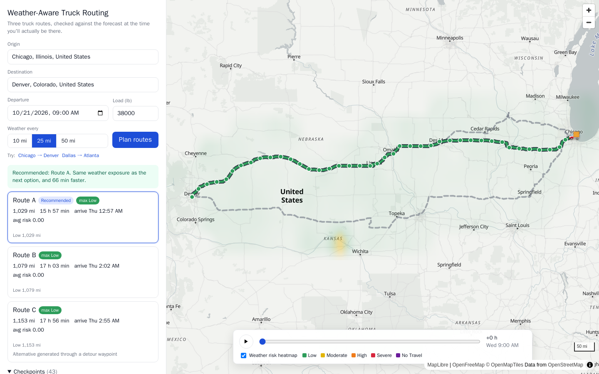

# Weather-Aware Truck Routing

A React + Django app that helps a truck driver choose the safest route. It looks at the weather forecast for the hour the truck will actually reach each point, the load weight, and the travel time.

**Live demo:** _<hosted URL>_ · **Walkthrough:** _<Loom URL>_



## What it does

1. The driver enters an origin, a destination, a departure time, the load weight, and a sampling interval (10, 25 or 50 miles).
2. The backend gets **3 truck routes**. It uses Valhalla's `truck` costing and passes the gross vehicle weight, so roads with weight restrictions are respected.
3. Each route is sampled **every N miles**, plus the origin and the destination. Every checkpoint gets an **ETA**, taken from the router's own per-maneuver timings, so slow urban stretches and fast interstate stretches are both accounted for.
4. For each checkpoint, the app interpolates the hourly forecast (wind, rain, snow) at that ETA and classifies it with the risk and load rules.
5. The routes are ranked: fewest Severe miles, then fewest High miles, then lowest average risk, then shortest travel time. The best one is recommended, with a one-line reason.
6. The map shows all routes. The selected route is coloured by risk between checkpoints, and each checkpoint has a popup with ETA, weather and the reason for its risk level. A **0–48 h forecast heatmap** covers the trip corridor, with a slider and a play button. A truck marker shows where the truck would be at the slider's hour.

## How the rules are applied

All of this lives in [`backend/routing/risk.py`](backend/routing/risk.py) as pure functions with table-driven tests.

| Condition | Low | Moderate | High | Severe | No Travel |
|---|---|---|---|---|---|
| Wind (mph) | < 25 | 25 – < 35 | 35 – < 45 | 45 – < 55 | ≥ 55 |
| Rain (in/hr) | < 0.10 | 0.10 – < 0.25 | 0.25 – < 0.50 | 0.50 – 1.00 | > 1.00 |
| Snow (in/hr) | < 0.5 | 0.5 – < 1.0 | 1.0 – < 2.0 | 2.0 – 3.0 | > 3.0 |

**Interpretation choices.** The brief's ranges share their endpoints ("0.10–0.25", "0.25–0.50"), so I had to pick a convention:

- **Shared boundaries** go to the higher band, because this is a safety tool. The top band is the exception: the brief defines it as strictly greater ("> 1.00"), so rain of exactly 1.00 in/hr is Severe.
- **Load rules** are applied on top of the wind band:
  - 45–54 mph with a load over 30,000 lb → No Travel.
  - 35–44 mph with a load over 40,000 lb → Severe.
  - ≥ 55 mph → No Travel for any load.

  "Load" means the cargo weight the driver enters. For routing, the truck's gross weight is that load plus 35,000 lb for a typical empty tractor-trailer.
- **Checkpoint risk** is the worst of the wind, rain and snow levels. The popup names whichever condition drove it.
- **Wind** uses the sustained 10 m wind speed, which is what the thresholds describe. Gusts are shown for context but are not scored.
- **Rain** is all liquid precipitation (Open-Meteo `rain` + `showers`). **Snow** is snowfall depth per hour.

### Risk miles and recommendation

Each stretch between two consecutive checkpoints takes the **worse** of its two endpoints. We only know the weather at the samples, and for safety it is better to over-count dangerous miles than to under-count them. That gives miles per level for each route. **Average risk** is the mileage-weighted mean of the level index (Low = 0 … No Travel = 4).

Routes are sorted by this key ([`planner.py`](backend/routing/planner.py)):

1. **No Travel miles.** The brief doesn't list this, but No Travel is strictly worse than Severe, so a route that crosses it can't beat one that doesn't.
2. Severe miles
3. High miles
4. Average risk, compared to one decimal. Two routes with near-identical averages (say 0.31 vs 0.33) are treated as tied, so the faster one wins instead of a meaningless difference deciding it.
5. Travel time

If even the best route has No Travel or Severe miles, the UI shows a warning that suggests delaying departure.

## Architecture

```
frontend/ (React 18 + TypeScript + Vite + MapLibre GL)
  src/App.tsx               state, request orchestration, truck position
  src/components/MapView    routes, risk-coloured segments, checkpoints, heatmap layer
  src/heatmap.ts            forecast grid -> 49 pre-rendered frames
backend/ (Django 5 + DRF)
  routing/risk.py           risk + load rules (pure)
  routing/geo.py            polyline decoding, sampling, ETA interpolation (pure)
  routing/planner.py        scoring, ranking, heatmap grid
  routing/providers/        Valhalla/OSRM, Open-Meteo, Nominatim clients
```

**API**

| Endpoint | Purpose |
|---|---|
| `GET /api/geocode?q=` | Place search for the origin/destination fields |
| `POST /api/plan` | `{origin, destination, departure, load_lb, interval_mi}` → 3 scored routes + recommendation |
| `POST /api/heatmap` | `{routes, start, load_lb}` → corridor grid with 49 hourly values per cell |

### Third-party services (all free, no API keys)

| Need | Service | Notes |
|---|---|---|
| Routing | [Valhalla](https://valhalla.github.io/valhalla/) public server, `truck` costing | Returns up to 2 alternates. [OSRM](https://project-osrm.org/) is the fallback. |
| Weather | [Open-Meteo](https://open-meteo.com/) hourly forecast | Many locations per request, mph and in/hr units. |
| Geocoding | [Nominatim](https://nominatim.org/) | US, Canada and Mexico only. |
| Basemap | [OpenFreeMap](https://openfreemap.org/) vector tiles | |

**Getting three routes.** Public routers often return fewer than three distinct alternatives. When that happens, the backend asks for detours through a waypoint offset to either side of the origin–destination midpoint. It keeps a detour only if less than 85% of it overlaps a route it already has, and only if it is no more than 60% longer than the main route. Detours are requested as two Valhalla legs, because the public server rejects multi-point requests over 1,500 km. That also keeps every option on the same truck speed model, so travel times stay comparable.

## Performance

- **One forecast request per plan.** The checkpoints of all three routes are fetched together and snapped to a 0.1° (~7 mi) grid, which is about the forecast model's own resolution. Shared corridor points are fetched once and then cached for 15 minutes.
- **The heatmap slider never makes a request.** The backend returns a coarse grid on a fixed global lattice, so repeat trips hit the cache. The browser turns it into 49 small PNG frames, interpolating bilinearly between grid points and spacing rows in Web Mercator to match the map projection. Moving the slider swaps one image source on the GPU.
- Routes are drawn from geometry thinned to about 0.5 mi. The heatmap loads in a second request, so the routes appear first.
- The route itself is cached for an hour, so changing only the interval or departure doesn't call the router again.

## Running locally

Requirements: Python 3.12 and Node 22, or just Docker.

```bash
# backend
python -m venv .venv && .venv/bin/pip install -r backend/requirements-dev.txt
cd backend && ../.venv/bin/python manage.py runserver        # http://localhost:8000/api/health

# frontend (dev server proxies /api to :8000)
cd frontend && npm install && npm run dev                     # http://localhost:5173

# tests
cd backend && ../.venv/bin/pytest -q
```

Or run the production image (React build served by Django/whitenoise):

```bash
docker build -t truck-routing . && docker run -p 8000:8000 -e DJANGO_ALLOWED_HOSTS=localhost truck-routing
```

## Deploying

`render.yaml` deploys the Dockerfile as a single Render web service. Any container host works; set `DJANGO_SECRET_KEY` and `DJANGO_ALLOWED_HOSTS`. The app is stateless and needs no database.

## Limitations and next steps

- **Public free APIs.** Valhalla and OSRM demo servers and Open-Meteo's free tier have rate limits. A production version would use a self-hosted router or a paid key, plus Redis instead of the per-process memory cache.
- **Departure window.** Departures are limited to the next 7 days. Forecasts get unreliable after that, and the heatmap covers 48 h from departure.
- **No hours-of-service breaks.** ETAs assume continuous driving. Adding the mandatory 30-min break and 10-h reset would shift later checkpoints' ETAs, and with them the weather each one sees.
- **Point samples.** Weather is sampled at checkpoints, so a narrow storm cell between two 50-mile checkpoints can be missed. The 10-mile interval reduces this.
- **Next ideas:** suggest the safest departure time within the next 24 h, and score gusts for high-profile empty trailers.
